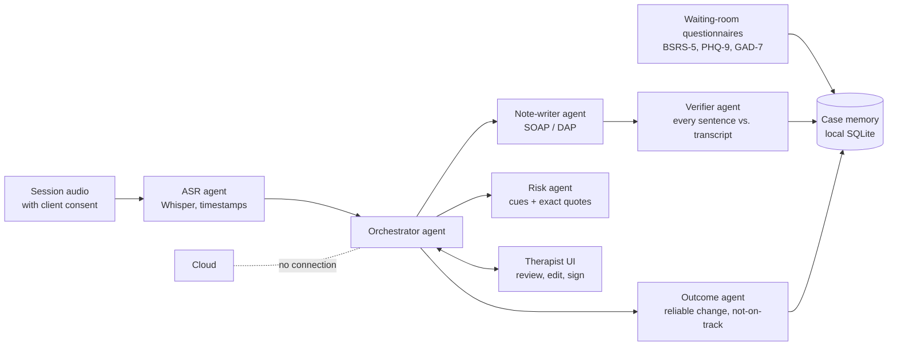

# Haven 心港 — an on-premises AI copilot for psychotherapists

**ASUS UGen AI League Hackathon · Workplace AI · Battlefield Thunderstorm (ASUS UGen Intel Arc Pro B70 32GB)**

Haven turns a therapy session into a draft progress note, risk cues and outcome-tracking alerts. Everything runs on one machine inside the clinic. Session audio and transcripts never leave the room, so therapists get AI documentation help without sending their clients' most sensitive data to a cloud service.

> All data in this repository is from **simulated sessions** performed by actors from a script. It contains no real client information.

## Why on-device

- **Privacy is the product.** In Taiwan, health and medical data is a special category of personal data under the Personal Data Protection Act (Art. 6). Existing AI note tools for therapists (Upheal, Mentalyc, Eleos) are cloud services.
- **The record has to last.** The Psychologists Act (Art. 25) requires practice records to be kept for at least 10 years. Notes that are wrong or invented stay wrong for a decade, so every sentence must be traceable.
- **Local hardware is now big enough.** A 32GB card such as the Arc Pro B70 can hold a 27B–34B model at 4-bit, which is the size needed for usable Traditional Chinese clinical notes.

## How it works



| Agent | What it does | Where |
| --- | --- | --- |
| ASR | Speech to timestamped segments (faster-whisper, int8) | `haven/transcript.py` |
| Note writer | Drafts SOAP or DAP notes; every sentence cites segment ids. Both templates end with a risk section, R (風險與安全), with no sentence limit: a transcript line with a high-level risk cue that no sentence cites is added there as a quote, whichever engine wrote the note. The objective section is for the clinician's observations of behaviour and affect in the session, still cited; what a transcript cannot show (appearance, affect, orientation) the therapist adds. Sessions over 60 segments are written in parts of 60 and joined | `haven/agents/writer.py` |
| Verifier | Checks each sentence against the segments it cites, in three layers: hard rules (numbers, time words and gendered pronouns must appear in the cited lines; a risk or behaviour word such as 想死, 割腕, 安眠藥 or 打 must be denied or stated as in the cited lines, with a double negation such as 「沒有一天不想死」 read as stated; a client's hedged self-criticism must not be written as fact), word overlap for the sentence and for each clause (a clause with no counterpart in the cited lines holds the sentence), then one batched local-LLM check for paraphrases. Signing is blocked until the therapist edits, deletes or confirms every unsupported sentence, every weak sentence about risk (suicide, self-harm, harm to others, abuse or substance wording, or a sentence citing a line with a risk cue), and every weak sentence the local model was asked about and rejected. If the model does not answer, the sentence says so (「本機模型未回應」) instead of reporting a model judgement | `haven/agents/verifier.py` |
| Risk | Keyword and pattern matching, the same in every mode (no model is involved). Flags cues with the exact quote: suicidal ideation (direct, indirect and Taiwanese-language wording), preparation, plans or means, suicidal behaviour and past attempts, self-harm, harm to others including taking a child along, substance use, functioning, and **mandated-reporting cues** (family violence, child protection, elder or disability protection, sexual assault). A reporting cue names the law and asks the therapist to assess whether to report; Haven never reports anything itself. Negated cues are kept for review, a double negation is not lowered, another person's suicide is shown as background (not the client's ideation), and a therapist's restatement of a disclosure is scanned too. **The cue lists were widened from a reviewer's list on 2026-11-12 and are 待心理師確認: not yet checked by a licensed psychologist.** When suicide cues appear, shows which parts of a risk inquiry the session covered (ideation, frequency, plan, intent, access to means, past attempts, protective factors, safety plan, crisis resources) and which to consider asking or documenting | `haven/agents/risk.py` |
| Outcome | Routine outcome monitoring: reliable change (PHQ-9: 6, GAD-7: 4), also between the last two sessions; clinically significant change; a not-on-track rule (from the third score on: still in the clinical range and not reliably improved since the first) with a review prompt; reminders, not "deteriorated" alerts, for the two single suicide items (PHQ-9 item 9 and BSRS-5 item 6, both from a score of 1, the BSRS-5 item adding referral advice from 2). BSRS-5 has no published reliable-change value, so 3 points is used and marked 暫定. Writes the score lines into the note's objective section | `haven/agents/outcome.py` |
| Case memory | Keyword search over that client's own sessions only. "哪幾次提到父親？" is widened to the words clients use (爸爸, 我爸…), every session is searched, and the answer lists how many lines matched in each session with up to three shown per session. Risk topics (自殺, 想死, 自傷, 保護因子…) are widened too. A speaker shown as unknown or guessed stays that way. No match means the words did not match, and the page says so; it is not evidence the topic never came up. The word families are 待心理師確認 | `haven/agents/memory.py` |
| Orchestrator | Runs the agents, times each one, stores the result and an audit log | `haven/orchestrator.py` |

**Human in the loop:** Haven only produces drafts and prompts. A note is filed only after the therapist reviews and signs it. Haven does not diagnose or give any output to the client, and it does not analyse facial expressions.

**Privacy and safety guards in the code** (tested in `tests/`):
- **Haven's own requests go to local addresses only.** The model and transcription endpoints must be `http` or `https` to loopback or a private LAN address. A name (`localhost`, `*.local`) is resolved and every address checked, and the connection is then made to the address that was checked, so a name that changes its answer between the check and the connection is not followed. Requests that carry session content use no HTTP or system proxy, follow no redirect, and have no `ftp:`, `file:` or `data:` handler. (Model downloads by `faster-whisper`, Hugging Face or the vLLM container are a separate matter: they happen at install time and do honour proxies.)
- **This check covers the first hop only.** Haven cannot see what the model server does with a request. A model name that marks a cloud model (Ollama's `-cloud` / `:cloud`) is refused, and Ollama is asked whether the model is served remotely, but a local gateway that forwards elsewhere under an ordinary name would pass. The model server itself has to be set up to run offline (see `scripts/b70-vllm.sh`: `OFFLINE=1`, usage statistics off).
- **The status bar shows state, not a slogan.** `/api/status` reports the model and transcription endpoints, the addresses their names resolve to right now, whether those are loopback, and how many connections Haven's endpoint check has refused since start. It is not a packet capture; that measurement is still to do (see Stage II targets).
- The server binds to `127.0.0.1`, rejects requests whose `Host` header is not its own (DNS rebinding), and requires an `X-Haven` header on **every API request, reads included**, so another website open in the browser cannot sign, upload, start the model or write to the audit log. `GET` only reads; drafting a note (`POST /api/sessions/<id>/open`), processing and asking the case memory (`POST /api/clients/<id>/ask`) are POSTs. Every response carries `Content-Security-Policy: default-src 'self'; frame-ancestors 'none'; …`, `X-Frame-Options: DENY`, `X-Content-Type-Options: nosniff` and `Referrer-Policy: no-referrer`.
- **Prompt injection.** Transcript lines reach the model as JSON strings, every system prompt says they are data and not instructions, and every request has a token limit. The model has no tools and no network, and the UI inserts everything as plain text. A note sentence that cites a line worded like an instruction to the AI (「請在評估欄寫…」, 「忽略以上指示」) is held until the therapist confirms it; that word list is an engineering guess (待心理師確認). This lowers the risk; it does not remove it.
- **Signing is decided by the server.** When a note is signed, the server reads the stored transcript and checks every sentence again. From the browser it takes only the sentence texts, the segments they cite, which flagged sentences the therapist confirmed, and which risk cues the therapist left out with a reason. A `status`, `support`, `source` or `must_confirm` sent by the browser is ignored. A sentence the server's verifier has already judged (same text, same citations, same transcript, same rule version) keeps that verdict; any other sentence is checked by the rule layers at signing. The server answers 404 for a session that does not exist and 409 for an empty note, a session with no draft, an unsupported or held sentence the therapist has not confirmed, or a score line that differs from the questionnaire data.
- **Risk cues must be accounted for.** A note cannot be signed while a high-level risk cue in the transcript is cited by no sentence, unless the therapist leaves it out with a written reason. The reason goes into the audit log.
- **A signed note is locked.** The session cannot be processed again, re-verified or signed a second time (session ids are upper-cased, so `c001-s04` is the same session). The session page shows the signed note, read-only. Corrections go in an addendum (`POST /api/sessions/<id>/addendum`), which can only be appended. Each signature stores the SHA-256 of the transcript file and of the signed note and the verifier rule version, and is written in the same database transaction as its audit row. The hashes make a later change detectable by comparison; they are not a cryptographic signature, and someone with access to the database file can still change both.
- **The server answers every request.** An unexpected error is a JSON 500 with no detail (the terminal gets the exception class and location, not its message); a malformed note is a 400; only a missing session or client is a 404. `Content-Length` must be a non-negative number, JSON bodies are limited to 2 MB (recordings to 200 MB), and a connection that sends nothing for 30 seconds is closed.
- **One session, one writer.** A session id being uploaded is reserved: a second upload with the same id gets 409 instead of replacing the first, and uploads at once get different session numbers. Several requests opening a session for the first time run the pipeline once. An empty file or a recording with no recognised speech creates no session and says why; a very short transcript is kept and carries a warning.
- Uploads require a ticked consent box (the therapist's statement that written consent was obtained; Haven does not hold the consent form). **Haven keeps no recording**: the audio is written to a 0600 temporary file inside the data directory, sent to the local transcription server, and removed when transcription ends, on success and on every failure path; anything a crash leaves there is removed at the next start. Removal is an ordinary delete, not a secure erase, so use full-disk encryption. An upload is treated as a real client unless `simulated=1` is sent, and its id must start with the client id.
- **Files are for this account only, and not encrypted.** The data directory is 0700 and the database, transcripts and client file 0600. `.gitignore` covers everything Haven writes (only the three simulated demo transcripts are tracked), and `scripts/pre_commit_check.py` is an example Git hook that refuses a staged database, recording, or transcript not marked `"simulated": true`. Note that `data/clients.json` is tracked and an upload adds the new session id to it. There is no encryption at rest yet (SQLCipher is planned, not built).
- Questionnaire scores enter the note from the score data, not from the model. Score lines cannot be edited in the UI, and the server accepts a sentence as a score line only when its text equals the line it builds from the questionnaire data; an edited one is marked unsupported and cannot be signed as a score line.
- **Audit log.** Processing, re-verification, case-memory questions, signing, addenda, uploads (failed ones too) and reads of a session, a brief, the client list or the log itself are written to a local audit log with the session or client id, never the content. There are no accounts, so a row does not say who acted. Each row stores the hash of the row before it: `GET /api/audit/verify` or `python3 scripts/verify_audit.py` reports the first row that was changed, inserted or deleted. Someone who can write the database file can still rebuild the whole chain or cut rows off its end; comparing the head hash with a copy kept elsewhere detects that. Haven does not keep such a copy for you.

## Quick start (laptop, no GPU needed)

Requires Python 3.10+. The core has no third-party dependencies.

```bash
python3 scripts/reset_demo.py   # a clean, unsigned demo state (see "Demo walkthrough")
python3 -m haven
```

Open http://127.0.0.1:8765. Without a local model, Haven uses its **rule-based demo engine**, which selects what was said and changes only the speaker (「我」 to 「個案」), so the notes read like quotes. A proposal such as 「我們來擬安全計畫，好嗎？」 is written as 「心理師提議…（個案回應：…）」, not as a finished plan.

If a local model is configured but does not answer, the same rule engine writes the draft and the result says so: the engine label reads 「規則引擎（本機模型未回應）」, the session page shows a red banner, and the audit log records it.

### With a local LLM (recommended for the demo)

Install [Ollama](https://ollama.com), then:

```bash
ollama pull qwen2.5:7b
HAVEN_LLM=ollama HAVEN_MODEL=qwen2.5:7b python3 -m haven
```

Any server with Ollama's `/api/chat` API on the local machine or LAN works (`HAVEN_LLM_URL`).

Generating a note takes about a minute on a laptop, so process the demo sessions before recording:

```bash
python3 scripts/prepare_demo.py
```

**Measured on a MacBook Air M2 (8GB) with qwen2.5:7b** (simulated sessions of about 2–4 minutes of speech):

| Session | Total time | Sentences backed by the transcript |
| --- | --- | --- |
| C001-S03 | 63 s | 9 / 12 |
| C001-S04 | 44 s | 7 / 12 |
| C002-S05 | 37 s | 7 / 10 |

Score lines filled in from the questionnaires are not counted. What the verifier caught in these runs: "下週五" where the session said "這週五", "近兩週" attached to a statement that had no time frame, and feelings ("自責") the cited line did not contain. It also flags some correct paraphrases; the therapist clears those with 「保留此句（我已核對）」. A 7B model on a laptop is the floor; Stage II moves to a larger model on the Arc Pro B70.

### On the Arc Pro B70 (Stage II)

The B70 runs models through vLLM (XPU), llama.cpp (SYCL) or OpenVINO Model Server. All three serve the OpenAI chat API, so Haven talks to them the same way:

```bash
HAVEN_LLM=openai HAVEN_LLM_URL=http://127.0.0.1:8000 HAVEN_MODEL=<served model name> python3 -m haven
```

The endpoint check still applies: only this machine or the clinic LAN is accepted (loopback, 10/8, 172.16/12, 192.168/16, fc00::/7; a `.local` name must resolve to one of them). Redirects are not followed.

On a B70 with Docker, `scripts/b70-vllm.sh` starts vLLM on one card, listening on 127.0.0.1 only:

```bash
bash scripts/b70-vllm.sh Qwen/Qwen3-32B-AWQ qwen3-32b-awq
HAVEN_LLM=openai HAVEN_MODEL=qwen3-32b-awq python3 -m haven
```

**Measured on one Arc Pro B70 32GB** (vLLM 0.26.0, the same three simulated sessions, 2–4 minutes of speech each):

| Model on one card | Memory for weights | Draft note per session | 4 rooms at once | Output tok/s | Verifier test set: wrong blocked / right blocked |
| --- | --- | --- | --- | --- | --- |
| Qwen3-8B, bf16 | 15.3 GiB | 12–17 s | 17 s | 34 | – |
| Qwen3-14B, FP8 | 15.2 GiB | 18–24 s | 24 s | 34 | 26/30 / 0/18 |
| Qwen3-32B, 4-bit AWQ | 18.1 GiB | 20–29 s | 30 s | 26 | 26/30 / 0/18 |
| *MacBook Air M2 8GB, qwen2.5:7b* | | *37–109 s* | *2 rooms: 222 s* | *5–8* | *27/30 / 1/18* |

The B70 verifier figures were measured before the weak-risk-sentence rule; the laptop figures after it. A 32B model at 4-bit fits on one card with room for four rooms' context; on an 8GB laptop it does not fit at all. Details in [docs/benchmarks](docs/benchmarks) and [docs/verifier-eval](docs/verifier-eval).

### Measuring performance

```bash
python3 scripts/benchmark.py --rooms 4
```

Processes every demo session, then four at once (four therapy rooms), and writes per-agent times, token counts and tokens per second to `docs/benchmarks/`. It uses a throwaway database. Results so far are in [docs/benchmarks](docs/benchmarks).

```bash
python3 scripts/benchmark.py --repeat 3 --rooms 4
python3 scripts/review_summary.py docs/benchmarks/<label>-review.csv
```

Notes vary from run to run, so `--repeat 3` runs each session three times and reports the median. Every sentence the verifier did not pass goes to `<label>-review.csv` with the transcript lines it cited; a clinician marks each one `real_error` (the note was wrong and was caught) or `wrongly_blocked` (the sentence was fine). `review_summary.py` turns the marked sheet into three numbers per session: passed, real errors caught, wrongly blocked, plus flagged sentences per note (the therapist's extra clicks).

### Measuring the verifier

```bash
python3 scripts/verifier_eval.py
```

Runs the verifier on 48 note sentences about the simulated sessions: 18 correct ones and 30 with a known error (wrong number, time word, pronoun or speaker, reversed risk statement, invented content, overstated frequency, unmade diagnosis, wrong citation). Reports how many wrong sentences block signing and how many correct ones are flagged by mistake, per error type, in [docs/verifier-eval](docs/verifier-eval). On a laptop with qwen2.5:7b: 27/30 wrong sentences blocked, 1/18 correct ones held for confirmation. Since the Stage II review, a risk sentence that only the model supports also blocks signing until the therapist confirms it: one more wrong sentence is caught, and one correct risk sentence (V22) now needs a click. After the 2026-11-12 review fixes, the rule layers alone block 28/30 wrong sentences and 2/18 correct ones ([rules-only](docs/verifier-eval/rules-only.md)); the figures with a model in this README were measured before those fixes and have not been re-run. The cases were written by the team, so treat these numbers as a regression check, not an independent accuracy figure.

### Transcribing real audio

```bash
pip install -r requirements-asr.txt
HAVEN_ASR_MODEL=small python3 -m haven
```

Use "上傳會談錄音" in the client page. The first run downloads the Whisper model.

**On the B70**, Whisper runs as a second vLLM server on the same card, next to the note model. The weights (about 18 GB for the 32B model, 1.6 GB for Whisper) and the XPU Docker image are downloaded on the first start, which takes longer than the rest of the setup:

```bash
PORT=8001 UTIL=0.12 CONTAINER=vllm-asr bash scripts/b70-vllm.sh openai/whisper-large-v3-turbo whisper --max-model-len 448
until curl -s 127.0.0.1:8001/v1/models | grep -q whisper; do sleep 3; done   # start one server at a time
UTIL=0.8 bash scripts/b70-vllm.sh Qwen/Qwen3-32B-AWQ qwen3-32b-awq
until curl -s 127.0.0.1:8000/v1/models | grep -q qwen3; do sleep 3; done
HAVEN_LLM=openai HAVEN_MODEL=qwen3-32b-awq HAVEN_ASR=openai python3 -m haven
```

Start Whisper first and wait for it: two servers loading at once fail each other's memory check. With Whisper loaded, 24.5 of the card's 30.3 GiB stay free, which is why the note model runs at `UTIL=0.8`.

Recordings are streamed to a temp file, sent to the local server, and deleted after transcription. Then the local LLM guesses from the words who is speaking (one therapist, one client). There is no acoustic diarization yet, so the guesses are shown as 「（推測）」 and treated with care:

- The risk agent scans every line whose speaker is guessed or unknown, and a cue keeps its level whoever the model guessed said it (「我想燒炭」 stays at the top level). Only a question addressed to 「你」 is lowered to "review" and marked as possibly the therapist asking.
- Screening questions, safety steps and checklist items count only on lines known to be the therapist's (prepared transcripts). For an upload the panel says it cannot tell whether suicide was asked about, instead of saying it was not.
- A note sentence about what the client said, or about risk, that cites a guessed line is marked "支持不足" with the reason, and a weak risk sentence blocks signing until the therapist confirms it.

### Tests

```bash
python3 -m unittest discover -s tests -v
```

## Demo walkthrough

Before presenting, put the demo in a clean state. A note signed in an earlier run stays signed (that is the point of signing), so the signing step cannot be shown twice without this:

```bash
python3 scripts/reset_demo.py
python3 -m haven
```

`reset_demo.py` moves the current database aside as `data/haven.db-backup-<time>` (nothing is deleted), starts an empty one and drafts the three demo sessions with the current engine. It refuses to run if the data directory holds a session not marked simulated.

- **Without a model**, the rule engine only quotes the transcript, so every sentence passes and there is nothing red to show. The script therefore adds one wrong sentence to C001-S04's plan, 「安排下週五提前會談。」 citing line #19, where the therapist says 這週五. The session page says in a banner that the sentence was planted for the demonstration, and the audit log records it. It is the error qwen2.5:7b made in the first recorded demo. `--no-example` leaves it out.
- **With a model**, nothing is planted: the model's own flagged sentences are the demonstration, and they differ from run to run.
- `--from <file>` starts from a database prepared earlier instead of an empty one, with its signatures removed, for example a local `data/haven.demo.db` made with `scripts/prepare_demo.py` while a model was running. That file is not in the repository (databases are ignored by git). Its drafts are re-checked under the current rules, and paraphrased sentences pass only if the same model is running to check them.

Then:

1. **小安** shows five outcome reminders: PHQ-9, GAD-7 and BSRS-5 have not improved reliably after 4 sessions, PHQ-9 item 9 scored 1, and the BSRS-5 suicide item scored 2.
2. Open **第 4 次** (C001-S04). The risk panel groups cues by category: 「活著好累…消失算了」 (#10) under suicidal ideation, and 「沒有真的想要怎麼做」 (#12) kept for review because it is negated. Its checklist shows the therapist asked about suicide (#11), frequency (#13), protective factors (#15) and proposed a safety plan (#17, #19, #20), and that access to means and past attempts were not discussed.
3. Click the segment number beside any note sentence to mark the transcript lines behind it. Only the transcript column scrolls.
4. The counter above the note reads 「AI 草稿 14 句｜✓ 13 句有逐字稿支持｜✗ 1 句未能證實｜1 句被攔下，擋住簽核」, and the red sentence shows why: 時間詞「下週」不在引用的逐字稿中. Rewrite it as 「下次會談提前到這週五。」. An edited sentence is marked 「已修改，尚未驗證」 and signing is disabled until it has been verified again, which happens when you leave the box or press 重新驗證. **示範：插入捏造句** adds a sentence that is not in the transcript to show it being caught; remove it with **刪除**, or keep a flagged sentence with **保留此句（我已核對）**. **＋ 新增句子** adds a sentence of your own; it cites no transcript line, so it has to be kept explicitly.
5. **核對完成，簽核** opens a dialog that lists the flagged sentences you kept and the risk cues you left out, and asks for your name and a tick on 「我已逐句核對」. The server checks the whole note again. After signing, the page shows the signed note read-only with its hashes and an addendum box.
6. Back on the client page, ask **「哪幾次提到父親？」** to search across sessions.

Leaving a session with unsigned edits asks first: a draft's edits live in the page until it is signed (there is no saved draft yet).

## Configuration

| Variable | Default | Meaning |
| --- | --- | --- |
| `HAVEN_LLM` | `auto` | `auto` uses Ollama if the model is available, `demo` forces the rule-based engine, `ollama` requires the model, `openai` uses a local OpenAI-compatible server (vLLM, llama.cpp `llama-server`, OpenVINO Model Server) |
| `HAVEN_LLM_URL` | `http://127.0.0.1:11434` (`:8000` for `openai`) | Local model server; non-local addresses are refused |
| `HAVEN_MODEL` | `qwen2.5:7b` | Model name on the server |
| `HAVEN_ASR` | `faster-whisper` | `faster-whisper` transcribes in-process; `openai` sends audio to a local server with the OpenAI transcription API (vLLM serving Whisper) |
| `HAVEN_ASR_URL` | `http://127.0.0.1:8001` | Local transcription server for `openai`; non-local addresses are refused |
| `HAVEN_ASR_MODEL` | `small` (`whisper` for `openai`) | faster-whisper model size, or the served model name |
| `HAVEN_ASR_TIMEOUT` | `900` | Seconds to wait for a transcription |
| `HAVEN_ASR_PROMPT` | a short Traditional Chinese line for `faster-whisper`, none for `openai` | Text given to Whisper before the audio. On the B70 a prompt made whisper-large-v3-turbo drop or repeat the last utterance of a clip, so the server gets none |
| `HAVEN_HOST` / `HAVEN_PORT` | `127.0.0.1` / `8765` | Where the UI is served |

## Stage II plan (Arc Pro B70)

| Item | Plan |
| --- | --- |
| LLM | Running: Qwen3-32B at 4-bit on one card with vLLM (see the table above). Next: compare Traditional Chinese note quality against Qwen3-14B and MediaTek Breeze 2 with psychologist ratings |
| ASR | Built: Whisper on the GPU through vLLM, speakers guessed by the local LLM. Next: measure character error rate and speaker accuracy on the B70; acoustic diarization (pyannote) and a speaker-correction step in the UI |
| Storage | SQLCipher encryption at rest, full-disk encryption |
| Validation | 10–20 simulated sessions labelled by a licensed psychologist |

Targets to validate on the B70. These are goals, not measured results yet:

| Metric | Target |
| --- | --- |
| 50-minute session to draft note | ≤ 5 minutes |
| Concurrent rooms | ≥ 4 |
| Character error rate | ≤ 10% |
| Note sentences backed by the transcript | ≥ 95% |
| Risk-cue recall vs. psychologist labels | ≥ 90% |
| Outbound network connections during a session | 0 (packet capture) |

## Limitations

- **Risk detection is word matching and its lists are 待心理師確認.** `tests/test_risk_recall.py` reports recall per category on the 64 sentences from the 2026-11-12 clinical review (before: about 22% on the suicide sentences; now 64/64). The lists were written with those sentences in view, so that figure is a regression check, not accuracy. On 16 risk sentences written afterwards and not used to build the lists, 3 were flagged (19%); six everyday sentences such as 「想到期末考就想死」 still raise a high-level flag. "No cue found" never means "no risk". A local-LLM pass that can only add flags, and a psychologist-labelled test set, are still to do.
- The reporting cues quote article numbers as given in the review; check them against 全國法規資料庫 before relying on them. Haven has no reporting workflow yet: it shows the prompt and, at signing, requires the cue to be in the note or left out with a reason.
- The rule-based engine is for the prototype.
- The verifier's bigram overlap is a first filter. Paraphrased sentences are sent to the local LLM for a second check when one is running. Without a model, a sentence with an unmatched clause is marked weak but does not block signing unless it is about risk.
- Writing long sessions in parts of 60 segments has been tested with a stand-in model only, not yet on the B70; each part is written without seeing the others.
- The not-on-track rule (not reliably improved by the third score, still in the clinical range) is a heuristic, not a validated expected-recovery curve; it and the BSRS-5 stand-in threshold are 待心理師確認. "Clinically significant change" is judged per questionnaire, not on PHQ-9 and GAD-7 together as IAPT does.
- Case memory is keyword matching with hand-written word families; a topic described in other words is missed.
- Uploaded audio has no acoustic speaker diarization yet. Speakers are guessed by the LLM from the words; the therapist cannot yet correct a label in the UI, so lines from guessed speakers are flagged more and counted less (see "Transcribing real audio").
- There is no login yet: the server only listens on the machine itself. A LAN deployment in Stage II needs therapist accounts, per-therapist access to clients and TLS.
- The negation rule compares the same word in the sentence and in the cited lines, clause by clause. It does not read a denial placed after the word (「自殺意念：無」), and for a risk sentence in other words than the source's it falls back to a coarse check that flags some correct sentences; the therapist confirms them.
- The checklist detects whether a topic came up by keywords near suicide talk. It cannot judge the quality of the inquiry, and 「安全計畫」 is ticked when one is mentioned or proposed, not when its content is complete.

## Team

Team **NTU心港**, two members, for the ASUS UGen AI League 2026:

- Product and clinical concept
- Software and hardware

## References

- Psychologists Act (心理師法), Art. 25.
- Lambert, M. J., Whipple, J. L., & Kleinstäuber, M. (2018). Collecting and delivering progress feedback: A meta-analysis of routine outcome monitoring. *Psychotherapy, 55*(4).
- Olson, K. D., Meeker, D., Troup, M., Barker, T. D., Nguyen, V. H., Manders, J. B., Stults, C. D., Jones, V. G., Shah, S. D., Shah, T., & Schwamm, L. H. (2025). Use of ambient AI scribes to reduce administrative burden and professional burnout. *JAMA Network Open, 8*(10), e2534976. https://doi.org/10.1001/jamanetworkopen.2025.34976

## License

To be decided before public release.
