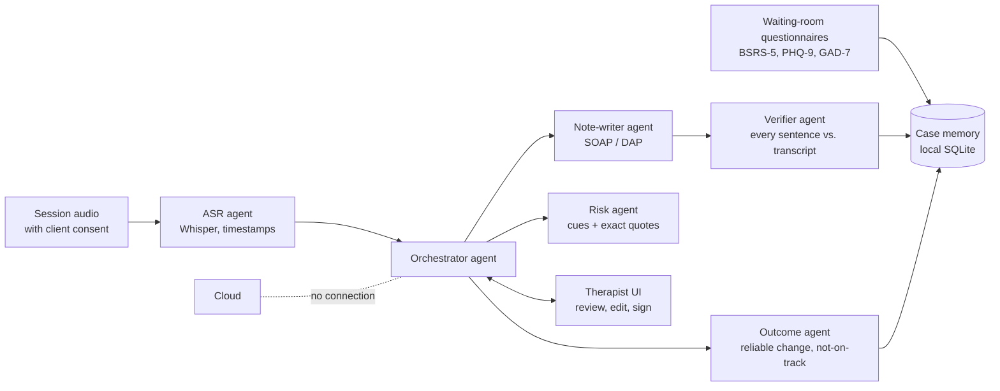

# Haven 心港 — an on-premises AI copilot for psychotherapists

**ASUS UGen AI League Hackathon · Workplace AI · Battlefield Thunderstorm (ASUS UGen Intel Arc Pro B70 32GB)**

Haven turns a therapy session into a draft progress note, risk cues and outcome-tracking alerts. Everything runs on one machine inside the clinic. Session audio and transcripts never leave the room, so therapists get AI documentation help without sending their clients' most sensitive data to a cloud service.

> All data in this repository is from **simulated sessions** performed by actors from a script. It contains no real client information.

## Why on-device

- **Privacy is the product.** In Taiwan, health and medical data is a special category of personal data under the Personal Data Protection Act (Art. 6). Existing AI note tools for therapists (Upheal, Mentalyc, Eleos) are cloud services.
- **The record has to last.** The Psychologists Act (Art. 25) requires practice records to be kept for at least 10 years. Notes that are wrong or invented stay wrong for a decade, so every sentence must be traceable.
- **Local hardware is now big enough.** A 32GB card such as the Arc Pro B70 can hold a 27B–34B model at 4-bit, which is the size needed for usable Traditional Chinese clinical notes.

## How it works



| Agent | What it does | Where |
| --- | --- | --- |
| ASR | Speech to timestamped segments (faster-whisper, int8) | `haven/transcript.py` |
| Note writer | Drafts SOAP or DAP notes; every sentence cites segment ids | `haven/agents/writer.py` |
| Verifier | Checks each sentence against the segments it cites, in three layers: hard rules (numbers, time words and gendered pronouns must appear in the cited lines), word overlap, then one batched local-LLM check for paraphrases. Unsupported sentences block signing until the therapist edits, deletes or confirms them | `haven/agents/verifier.py` |
| Risk | Flags suicide, self-harm, violence and functioning cues with the exact quote; keeps negated cues for review; checks whether screening and safety steps appear in the session | `haven/agents/risk.py` |
| Outcome | Routine outcome monitoring: reliable change (PHQ-9: 6, GAD-7: 4), not-on-track heuristic, BSRS-5 suicide-item alert | `haven/agents/outcome.py` |
| Case memory | Answers "which sessions mentioned her father?" from that client's own sessions only | `haven/agents/memory.py` |
| Orchestrator | Runs the agents, times each one, stores the result and an audit log | `haven/orchestrator.py` |

**Human in the loop:** Haven only produces drafts and prompts. A note is filed only after the therapist reviews and signs it. Haven does not diagnose or give any output to the client, and it does not analyse facial expressions.

**Privacy guards in the code:**
- The LLM client refuses any endpoint that is not loopback or a private LAN address (`haven/llm.py`, tested in `tests/test_agents.py`).
- The server binds to `127.0.0.1` by default and keeps transcripts out of its console log.
- Uploaded audio is written to a temporary file and deleted right after transcription.
- Every processing, query and signing action is written to an audit log.

## Quick start (laptop, no GPU needed)

Requires Python 3.10+. The core has no third-party dependencies.

```bash
python3 -m haven
```

Open http://127.0.0.1:8765. Without a local model, Haven uses its **rule-based demo engine**, which selects and rewrites what was said. It cannot invent content, but the notes read like quotes.

### With a local LLM (recommended for the demo)

Install [Ollama](https://ollama.com), then:

```bash
ollama pull qwen2.5:7b
HAVEN_LLM=ollama HAVEN_MODEL=qwen2.5:7b python3 -m haven
```

Any server with Ollama's `/api/chat` API on the local machine or LAN works (`HAVEN_LLM_URL`).

Generating a note takes about a minute on a laptop, so process the demo sessions before recording:

```bash
python3 scripts/prepare_demo.py
```

**Measured on a MacBook Air M2 (8GB) with qwen2.5:7b** (simulated sessions of about 2–4 minutes of speech):

| Session | Total time | Sentences backed by the transcript |
| --- | --- | --- |
| C001-S03 | 59 s | 9 / 11 |
| C001-S04 | 88 s | 12 / 15 |
| C002-S05 | 68 s | 6 / 10 |

What the verifier caught in these runs: "下週五" where the session said "這週五", "近兩週" attached to a statement that had no time frame, and feelings ("自責") the cited line did not contain. It also flags some correct paraphrases; the therapist clears those with "確認無誤". A 7B model on a laptop is the floor; Stage II moves to a larger model on the Arc Pro B70.

### Transcribing real audio

```bash
pip install -r requirements-asr.txt
HAVEN_ASR_MODEL=small python3 -m haven
```

Use "上傳會談錄音" in the client page. The first run downloads the Whisper model.

### Tests

```bash
python3 -m unittest discover -s tests -v
```

## Demo walkthrough

1. **小安** shows four outcome alerts: PHQ-9, GAD-7 and BSRS-5 are not improving after 4 sessions, and the BSRS-5 suicide item scored 2.
2. Open **C001-S04**. The risk panel flags 「活著好累…消失算了」 (#10) as suicidal ideation, and keeps 「沒有真的想要怎麼做」 (#12) for review because it is negated. It confirms the therapist asked about suicide (#11) and made a safety plan (#17, #19, #20). It lists the protective factors: sister and cat (#16).
3. Click any note sentence to jump to the transcript lines behind it.
4. Red sentences show why they were flagged. Fix the date in "安排下週五提前會談" and the verifier clears it; click **確認無誤** on a correct paraphrase. **加入測試句** inserts a sentence that is not in the transcript to show it being caught. Signing stays blocked until every red sentence is fixed, removed or confirmed.
5. Ask **「哪幾次提到父親？」** to search across sessions.

## Configuration

| Variable | Default | Meaning |
| --- | --- | --- |
| `HAVEN_LLM` | `auto` | `auto` uses Ollama if the model is available, `demo` forces the rule-based engine, `ollama` requires the model |
| `HAVEN_LLM_URL` | `http://127.0.0.1:11434` | Local model server; non-local addresses are refused |
| `HAVEN_MODEL` | `qwen2.5:7b` | Model name on the server |
| `HAVEN_ASR_MODEL` | `small` | faster-whisper model size |
| `HAVEN_HOST` / `HAVEN_PORT` | `127.0.0.1` / `8765` | Where the UI is served |

## Stage II plan (Arc Pro B70)

| Item | Plan |
| --- | --- |
| LLM | 14B–32B model at 4-bit (Qwen3, Gemma 3 or MediaTek Breeze 2) served by OpenVINO GenAI or llama.cpp with the OpenVINO backend |
| ASR | Whisper large-v3 or Breeze-ASR on the GPU; pyannote speaker diarization |
| Storage | SQLCipher encryption at rest, full-disk encryption |
| Validation | 10–20 simulated sessions labelled by a licensed psychologist |

Targets to validate on the B70. These are goals, not measured results yet:

| Metric | Target |
| --- | --- |
| 50-minute session to draft note | ≤ 5 minutes |
| Concurrent rooms | ≥ 4 |
| Character error rate | ≤ 10% |
| Note sentences backed by the transcript | ≥ 95% |
| Risk-cue recall vs. psychologist labels | ≥ 90% |
| Outbound network connections during a session | 0 (packet capture) |

## Limitations

- The rule-based engine and the risk lexicon are for the prototype. Lexicon matching misses indirect expressions; the Stage II LLM pass and psychologist-labelled test data address this.
- The verifier's bigram overlap is a first filter. Paraphrased sentences are sent to the local LLM for a second check when one is running.
- The not-on-track rule is a simple heuristic, not a validated expected-recovery curve.
- Uploaded audio is not yet split by speaker.

## References

- Psychologists Act (心理師法), Art. 25.
- Lambert, M. J., Whipple, J. L., & Kleinstäuber, M. (2018). Collecting and delivering progress feedback: A meta-analysis of routine outcome monitoring. *Psychotherapy, 55*(4).
- Olson, K. D. et al. (2025). Use of ambient AI scribes and clinician burnout. *JAMA Network Open*.

## License

To be decided before public release.
