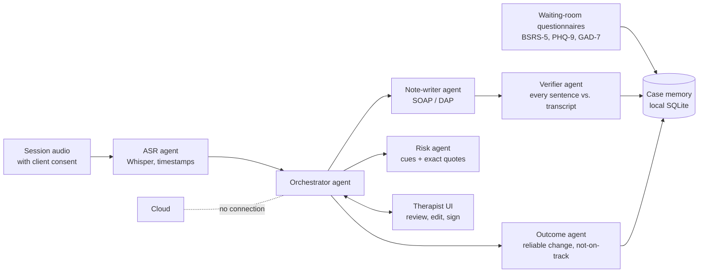

# Haven 心港 — an on-premises AI copilot for psychotherapists

**ASUS UGen AI League Hackathon · Workplace AI · Battlefield Thunderstorm (ASUS UGen Intel Arc Pro B70 32GB)**

Haven turns a therapy session into a draft progress note, risk cues and outcome-tracking alerts. Everything runs on one machine inside the clinic. Session audio and transcripts never leave the room, so therapists get AI documentation help without sending their clients' most sensitive data to a cloud service.

> All data in this repository is from **simulated sessions** performed by actors from a script. It contains no real client information.

## Why on-device

- **Privacy is the product.** In Taiwan, health and medical data is a special category of personal data under the Personal Data Protection Act (Art. 6). Existing AI note tools for therapists (Upheal, Mentalyc, Eleos) are cloud services.
- **The record has to last.** The Psychologists Act (Art. 25) requires practice records to be kept for at least 10 years. Notes that are wrong or invented stay wrong for a decade, so every sentence must be traceable.
- **Local hardware is now big enough.** A 32GB card such as the Arc Pro B70 can hold a 27B–34B model at 4-bit, which is the size needed for usable Traditional Chinese clinical notes.

## How it works



| Agent | What it does | Where |
| --- | --- | --- |
| ASR | Speech to timestamped segments (faster-whisper, int8) | `haven/transcript.py` |
| Note writer | Drafts SOAP or DAP notes; every sentence cites segment ids | `haven/agents/writer.py` |
| Verifier | Checks each sentence against the segments it cites, in three layers: hard rules (numbers, time words and gendered pronouns must appear in the cited lines; a risk sentence must keep the cited lines' negation), word overlap, then one batched local-LLM check for paraphrases. Signing is blocked until the therapist edits, deletes or confirms every unsupported sentence, every weak sentence about risk, and every weak sentence the local model was asked about and rejected | `haven/agents/verifier.py` |
| Risk | Flags suicide, self-harm, violence and functioning cues with the exact quote; keeps negated cues for review; when suicide cues appear, shows which parts of a risk inquiry the session covered (ideation, frequency, plan, intent, access to means, past attempts, protective factors, safety plan, crisis resources) and which to consider asking or documenting | `haven/agents/risk.py` |
| Outcome | Routine outcome monitoring: reliable change (PHQ-9: 6, GAD-7: 4), clinically significant change, not-on-track heuristic with a review prompt, PHQ-9 item 9 and BSRS-5 suicide-item alerts; writes the score lines into the note's objective section | `haven/agents/outcome.py` |
| Case memory | Answers "which sessions mentioned her father?" from that client's own sessions only | `haven/agents/memory.py` |
| Orchestrator | Runs the agents, times each one, stores the result and an audit log | `haven/orchestrator.py` |

**Human in the loop:** Haven only produces drafts and prompts. A note is filed only after the therapist reviews and signs it. Haven does not diagnose or give any output to the client, and it does not analyse facial expressions.

**Privacy and safety guards in the code** (tested in `tests/`):
- The LLM client refuses any endpoint that is not loopback or a private LAN address, and never goes through an HTTP or system proxy.
- The server binds to `127.0.0.1`, rejects requests whose `Host` header is not its own (DNS rebinding), and requires an `X-Haven` header on every POST, so another website open in the browser cannot sign or upload.
- **Signing is decided by the server.** When a note is signed, the server reads the stored transcript and checks every sentence again. From the browser it takes only the sentence texts, the segments they cite, which flagged sentences the therapist confirmed, and which risk cues the therapist left out with a reason. A `status`, `support`, `source` or `must_confirm` sent by the browser is ignored. A sentence the server's verifier has already judged (same text, same citations, same transcript, same rule version) keeps that verdict; any other sentence is checked by the rule layers at signing. The server answers 404 for a session that does not exist and 409 for an empty note, a session with no draft, an unsupported or held sentence the therapist has not confirmed, or a score line that differs from the questionnaire data.
- **Risk cues must be accounted for.** A note cannot be signed while a high-level risk cue in the transcript is cited by no sentence, unless the therapist leaves it out with a written reason. The reason goes into the audit log.
- **A signed note is locked.** The session cannot be processed again, re-verified or signed a second time (session ids are upper-cased, so `c001-s04` is the same session). The session page shows the signed note, read-only. Corrections go in an addendum (`POST /api/sessions/<id>/addendum`), which can only be appended. Each signature stores the SHA-256 of the transcript file and of the signed note and the verifier rule version, and is written in the same database transaction as its audit row. The hashes make a later change detectable by comparison; they are not a cryptographic signature, and someone with access to the database file can still change both (a hash-chained audit log is planned).
- Uploads require the client's written consent to recording. The audio is written to a temporary file and deleted right after transcription.
- Questionnaire scores enter the note from the score data, not from the model. Score lines cannot be edited in the UI, and the server accepts a sentence as a score line only when its text equals the line it builds from the questionnaire data; an edited one is marked unsupported and cannot be signed as a score line.
- Every processing, query and signing action is written to an audit log.

## Quick start (laptop, no GPU needed)

Requires Python 3.10+. The core has no third-party dependencies.

```bash
python3 -m haven
```

Open http://127.0.0.1:8765. Without a local model, Haven uses its **rule-based demo engine**, which selects and rewrites what was said. It cannot invent content, but the notes read like quotes.

### With a local LLM (recommended for the demo)

Install [Ollama](https://ollama.com), then:

```bash
ollama pull qwen2.5:7b
HAVEN_LLM=ollama HAVEN_MODEL=qwen2.5:7b python3 -m haven
```

Any server with Ollama's `/api/chat` API on the local machine or LAN works (`HAVEN_LLM_URL`).

Generating a note takes about a minute on a laptop, so process the demo sessions before recording:

```bash
python3 scripts/prepare_demo.py
```

**Measured on a MacBook Air M2 (8GB) with qwen2.5:7b** (simulated sessions of about 2–4 minutes of speech):

| Session | Total time | Sentences backed by the transcript |
| --- | --- | --- |
| C001-S03 | 63 s | 9 / 12 |
| C001-S04 | 44 s | 7 / 12 |
| C002-S05 | 37 s | 7 / 10 |

Score lines filled in from the questionnaires are not counted. What the verifier caught in these runs: "下週五" where the session said "這週五", "近兩週" attached to a statement that had no time frame, and feelings ("自責") the cited line did not contain. It also flags some correct paraphrases; the therapist clears those with "確認無誤". A 7B model on a laptop is the floor; Stage II moves to a larger model on the Arc Pro B70.

### On the Arc Pro B70 (Stage II)

The B70 runs models through vLLM (XPU), llama.cpp (SYCL) or OpenVINO Model Server. All three serve the OpenAI chat API, so Haven talks to them the same way:

```bash
HAVEN_LLM=openai HAVEN_LLM_URL=http://127.0.0.1:8000 HAVEN_MODEL=<served model name> python3 -m haven
```

The endpoint check still applies: only this machine or the clinic LAN is accepted (loopback, 10/8, 172.16/12, 192.168/16, fc00::/7; a `.local` name must resolve to one of them). Redirects are not followed.

On a B70 with Docker, `scripts/b70-vllm.sh` starts vLLM on one card, listening on 127.0.0.1 only:

```bash
bash scripts/b70-vllm.sh Qwen/Qwen3-32B-AWQ qwen3-32b-awq
HAVEN_LLM=openai HAVEN_MODEL=qwen3-32b-awq python3 -m haven
```

**Measured on one Arc Pro B70 32GB** (vLLM 0.26.0, the same three simulated sessions, 2–4 minutes of speech each):

| Model on one card | Memory for weights | Draft note per session | 4 rooms at once | Output tok/s | Verifier test set: wrong blocked / right blocked |
| --- | --- | --- | --- | --- | --- |
| Qwen3-8B, bf16 | 15.3 GiB | 12–17 s | 17 s | 34 | – |
| Qwen3-14B, FP8 | 15.2 GiB | 18–24 s | 24 s | 34 | 26/30 / 0/18 |
| Qwen3-32B, 4-bit AWQ | 18.1 GiB | 20–29 s | 30 s | 26 | 26/30 / 0/18 |
| *MacBook Air M2 8GB, qwen2.5:7b* | | *37–109 s* | *2 rooms: 222 s* | *5–8* | *27/30 / 1/18* |

The B70 verifier figures were measured before the weak-risk-sentence rule; the laptop figures after it. A 32B model at 4-bit fits on one card with room for four rooms' context; on an 8GB laptop it does not fit at all. Details in [docs/benchmarks](docs/benchmarks) and [docs/verifier-eval](docs/verifier-eval).

### Measuring performance

```bash
python3 scripts/benchmark.py --rooms 4
```

Processes every demo session, then four at once (four therapy rooms), and writes per-agent times, token counts and tokens per second to `docs/benchmarks/`. It uses a throwaway database. Results so far are in [docs/benchmarks](docs/benchmarks).

```bash
python3 scripts/benchmark.py --repeat 3 --rooms 4
python3 scripts/review_summary.py docs/benchmarks/<label>-review.csv
```

Notes vary from run to run, so `--repeat 3` runs each session three times and reports the median. Every sentence the verifier did not pass goes to `<label>-review.csv` with the transcript lines it cited; a clinician marks each one `real_error` (the note was wrong and was caught) or `wrongly_blocked` (the sentence was fine). `review_summary.py` turns the marked sheet into three numbers per session: passed, real errors caught, wrongly blocked, plus flagged sentences per note (the therapist's extra clicks).

### Measuring the verifier

```bash
python3 scripts/verifier_eval.py
```

Runs the verifier on 48 note sentences about the simulated sessions: 18 correct ones and 30 with a known error (wrong number, time word, pronoun or speaker, reversed risk statement, invented content, overstated frequency, unmade diagnosis, wrong citation). Reports how many wrong sentences block signing and how many correct ones are flagged by mistake, per error type, in [docs/verifier-eval](docs/verifier-eval). On a laptop with qwen2.5:7b: 27/30 wrong sentences blocked, 1/18 correct ones held for confirmation. Since the Stage II review, a risk sentence that only the model supports also blocks signing until the therapist confirms it: one more wrong sentence is caught, and one correct risk sentence (V22) now needs a click. The cases were written by the team, so treat these numbers as a regression check, not an independent accuracy figure.

### Transcribing real audio

```bash
pip install -r requirements-asr.txt
HAVEN_ASR_MODEL=small python3 -m haven
```

Use "上傳會談錄音" in the client page. The first run downloads the Whisper model.

**On the B70**, Whisper runs as a second vLLM server on the same card, next to the note model. The weights (about 18 GB for the 32B model, 1.6 GB for Whisper) and the XPU Docker image are downloaded on the first start, which takes longer than the rest of the setup:

```bash
PORT=8001 UTIL=0.12 CONTAINER=vllm-asr bash scripts/b70-vllm.sh openai/whisper-large-v3-turbo whisper --max-model-len 448
until curl -s 127.0.0.1:8001/v1/models | grep -q whisper; do sleep 3; done   # start one server at a time
UTIL=0.8 bash scripts/b70-vllm.sh Qwen/Qwen3-32B-AWQ qwen3-32b-awq
until curl -s 127.0.0.1:8000/v1/models | grep -q qwen3; do sleep 3; done
HAVEN_LLM=openai HAVEN_MODEL=qwen3-32b-awq HAVEN_ASR=openai python3 -m haven
```

Start Whisper first and wait for it: two servers loading at once fail each other's memory check. With Whisper loaded, 24.5 of the card's 30.3 GiB stay free, which is why the note model runs at `UTIL=0.8`.

Recordings are streamed to a temp file, sent to the local server, and deleted after transcription. Then the local LLM guesses from the words who is speaking (one therapist, one client). There is no acoustic diarization yet, so the guesses are shown with "?" and treated with care:

- The risk agent scans every line whose speaker is guessed or unknown. A guessed-therapist line or a question that contains a cue is kept at "review" with "說話者未確認", never dropped.
- Screening questions, safety steps and checklist items count only on lines known to be the therapist's (prepared transcripts).
- A note sentence about what the client said, or about risk, that cites a guessed line is marked "支持不足" with the reason, and a weak risk sentence blocks signing until the therapist confirms it.

### Tests

```bash
python3 -m unittest discover -s tests -v
```

## Demo walkthrough

1. **小安** shows four outcome alerts: PHQ-9, GAD-7 and BSRS-5 are not improving after 4 sessions, and the BSRS-5 suicide item scored 2.
2. Open **C001-S04**. The risk panel flags 「活著好累…消失算了」 (#10) as suicidal ideation, and keeps 「沒有真的想要怎麼做」 (#12) for review because it is negated. Its checklist shows the therapist asked about suicide (#11), frequency (#13), protective factors (#15) and made a safety plan (#17, #19, #20), and that access to means and past attempts were not discussed.
3. Click any note sentence to jump to the transcript lines behind it.
4. Red sentences show why they were flagged. Rewrite "安排下週五提前會談" as "下次會談提前到這週五。" and the verifier clears it; click **確認無誤** on a correct paraphrase. **加入測試句** inserts a sentence that is not in the transcript to show it being caught. Signing stays blocked until every red sentence is fixed, removed or confirmed, and the server checks this again itself. After signing, the page shows the signed note read-only with its hashes, and an addendum box.
5. Ask **「哪幾次提到父親？」** to search across sessions.

## Configuration

| Variable | Default | Meaning |
| --- | --- | --- |
| `HAVEN_LLM` | `auto` | `auto` uses Ollama if the model is available, `demo` forces the rule-based engine, `ollama` requires the model, `openai` uses a local OpenAI-compatible server (vLLM, llama.cpp `llama-server`, OpenVINO Model Server) |
| `HAVEN_LLM_URL` | `http://127.0.0.1:11434` (`:8000` for `openai`) | Local model server; non-local addresses are refused |
| `HAVEN_MODEL` | `qwen2.5:7b` | Model name on the server |
| `HAVEN_ASR` | `faster-whisper` | `faster-whisper` transcribes in-process; `openai` sends audio to a local server with the OpenAI transcription API (vLLM serving Whisper) |
| `HAVEN_ASR_URL` | `http://127.0.0.1:8001` | Local transcription server for `openai`; non-local addresses are refused |
| `HAVEN_ASR_MODEL` | `small` (`whisper` for `openai`) | faster-whisper model size, or the served model name |
| `HAVEN_ASR_TIMEOUT` | `900` | Seconds to wait for a transcription |
| `HAVEN_ASR_PROMPT` | a short Traditional Chinese line for `faster-whisper`, none for `openai` | Text given to Whisper before the audio. On the B70 a prompt made whisper-large-v3-turbo drop or repeat the last utterance of a clip, so the server gets none |
| `HAVEN_HOST` / `HAVEN_PORT` | `127.0.0.1` / `8765` | Where the UI is served |

## Stage II plan (Arc Pro B70)

| Item | Plan |
| --- | --- |
| LLM | Running: Qwen3-32B at 4-bit on one card with vLLM (see the table above). Next: compare Traditional Chinese note quality against Qwen3-14B and MediaTek Breeze 2 with psychologist ratings |
| ASR | Built: Whisper on the GPU through vLLM, speakers guessed by the local LLM. Next: measure character error rate and speaker accuracy on the B70; acoustic diarization (pyannote) and a speaker-correction step in the UI |
| Storage | SQLCipher encryption at rest, full-disk encryption |
| Validation | 10–20 simulated sessions labelled by a licensed psychologist |

Targets to validate on the B70. These are goals, not measured results yet:

| Metric | Target |
| --- | --- |
| 50-minute session to draft note | ≤ 5 minutes |
| Concurrent rooms | ≥ 4 |
| Character error rate | ≤ 10% |
| Note sentences backed by the transcript | ≥ 95% |
| Risk-cue recall vs. psychologist labels | ≥ 90% |
| Outbound network connections during a session | 0 (packet capture) |

## Limitations

- The rule-based engine and the risk lexicon are for the prototype. Lexicon matching misses indirect expressions; the Stage II LLM pass and psychologist-labelled test data address this.
- The verifier's bigram overlap is a first filter. Paraphrased sentences are sent to the local LLM for a second check when one is running.
- The not-on-track rule is a simple heuristic, not a validated expected-recovery curve.
- Uploaded audio has no acoustic speaker diarization yet. Speakers are guessed by the LLM from the words; the therapist cannot yet correct a label in the UI, so lines from guessed speakers are flagged more and counted less (see "Transcribing real audio").
- There is no login yet: the server only listens on the machine itself. A LAN deployment in Stage II needs therapist accounts, per-therapist access to clients and TLS.
- The negation rule for risk sentences is deliberately strict and flags some correct sentences; the therapist confirms them.
- The checklist detects whether a topic came up by keywords. It cannot judge the quality of the inquiry.

## Team

Team **NTU心港**, two members, for the ASUS UGen AI League 2026:

- Product and clinical concept
- Software and hardware

## References

- Psychologists Act (心理師法), Art. 25.
- Lambert, M. J., Whipple, J. L., & Kleinstäuber, M. (2018). Collecting and delivering progress feedback: A meta-analysis of routine outcome monitoring. *Psychotherapy, 55*(4).
- Olson, K. D., Meeker, D., Troup, M., Barker, T. D., Nguyen, V. H., Manders, J. B., Stults, C. D., Jones, V. G., Shah, S. D., Shah, T., & Schwamm, L. H. (2025). Use of ambient AI scribes to reduce administrative burden and professional burnout. *JAMA Network Open, 8*(10), e2534976. https://doi.org/10.1001/jamanetworkopen.2025.34976

## License

To be decided before public release.
